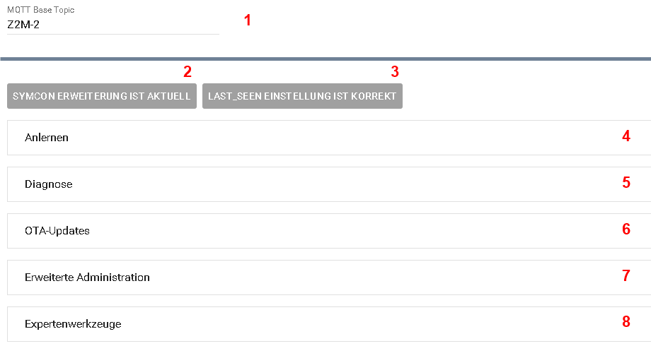
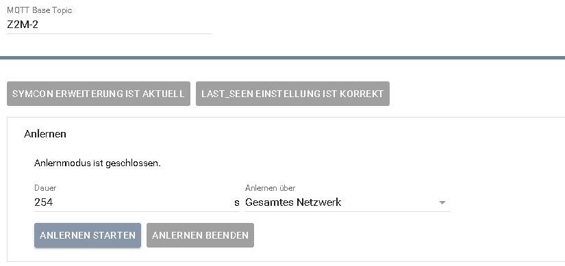
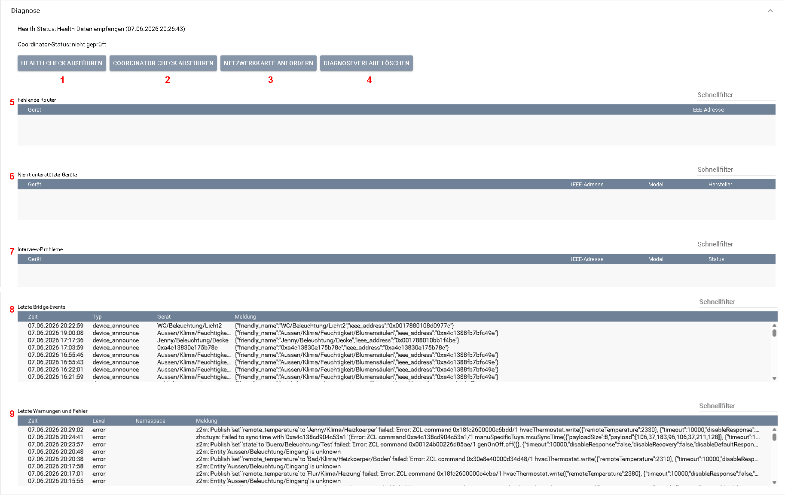
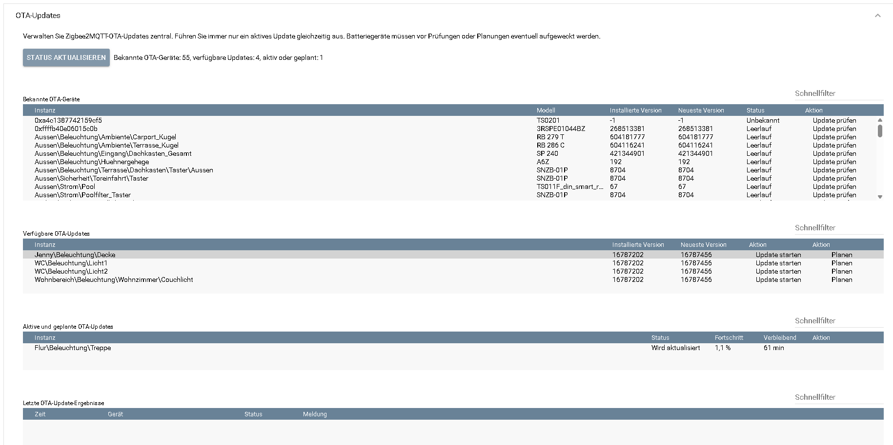
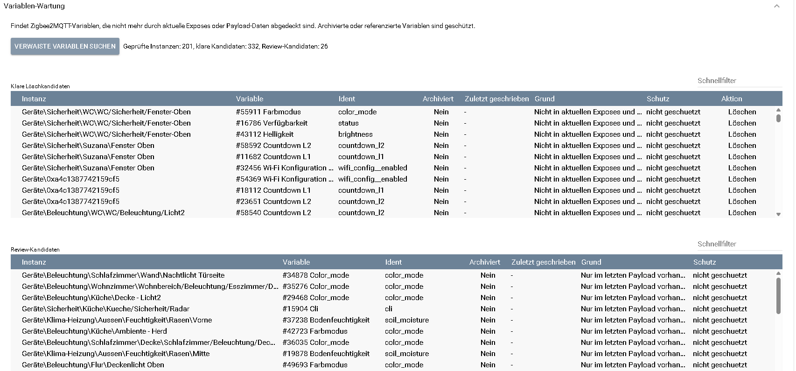
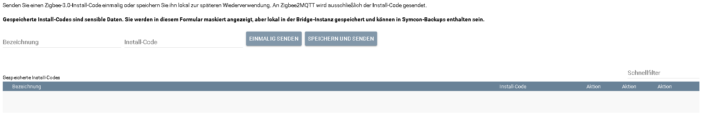
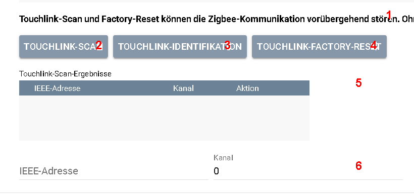

[Deutsch](README.md) | [English](README.en.md)

# Zigbee2MQTT Bridge

The Bridge provides installation-wide Zigbee2MQTT settings, extension management, pairing, diagnostics, firmware updates and administrative tools. It belongs to the [Zigbee2MQTT library](../README.en.md).

## Requirements and installation

- Symcon 9.1 or newer, a running [Zigbee2MQTT](https://www.zigbee2mqtt.io) installation and an MQTT broker.
- A Symcon MQTT Client connected to the external broker, or a Symcon MQTT Server used by Zigbee2MQTT.
- The correct MQTT base topic. Each Zigbee2MQTT installation on a shared broker needs a distinct base topic.

Create the Bridge through the [Configurator](../Configurator/README.en.md). This supplies its MQTT connection and base topic. Install or update the Symcon extension in Zigbee2MQTT manually from the Bridge; a module update does not install it automatically. Follow the [library installation and migration instructions](../README.en.md) and create a complete Symcon backup before upgrading from 5.x or an earlier testing version.

## Configuration



| Section | Purpose |
| --- | --- |
| MQTT Base Topic | The matching Zigbee2MQTT base topic; change it only when the installation changes. |
| Symcon extension | Displays installed/bundled versions and offers manual installation or update. |
| last_seen | Checks for `epoch` output and offers a button to set it. |
| Pairing | Opens network join globally, through the coordinator or through a selected router. |
| Diagnostics | Health/coordinator checks, network map and device/event warnings. |
| OTA updates | Checks, starts, schedules and monitors device firmware updates. |
| Advanced administration | Network security, variable maintenance and Zigbee2MQTT maintenance. |
| Test center | Direct access to Bridge status variables from the top-level form. |

The version line retains the last reported Zigbee2MQTT version. A separate Online/Offline line considers both the reported Zigbee2MQTT status and current MQTT connection, updates while the form is open and marks offline version information as last reported data. Reconnecting does not clear version information.

The bundled **extension 6.09** resolves dynamic device exposes for groups using current device options. A failing/unresolved group member no longer aborts the entire response: available members are retained, the failed member is logged and is tried again on the next query. OTA detection uses modern `definition.ota`, falling back to legacy `supports_ota` only when `ota` is absent. The normalized information sent to Symcon is still called `supports_ota`. Apply these fixes by manually updating the extension and requesting device/group information again.

## Bridge functions

### Pairing



Choose a duration of **1–254 seconds** and select the whole network, `coordinator` or a known router. Start opens network joining; Stop ends it early. The form shows the current target and remaining time. The router must be powered and reachable. Selecting a router does not guarantee that a device will choose it or remain connected through it.

For existing scripts, enabling **Allow joining the network** still opens joining globally for 254 seconds. Disabling it stops joining. Keep the persistent global `permit_join` option disabled for normal operation; use the temporary joining controls when pairing devices.

### Diagnostics



- **Health check** asks whether Zigbee2MQTT is healthy and displays the last result and timestamp.
- **Coordinator check** reports missing routers.
- **Request network map** retains the older Graphviz request; use the dedicated [Network Map module](../NetworkMap/README.en.md) for interactive topology, routing and detailed lists.
- Tables list missing routers, unsupported devices, incomplete/failed interviews, recent Bridge events and recent warnings/errors. Quick filters help with large networks. An entry is a diagnostic hint, not proof of a hardware defect.
- **Clear diagnostic history** removes collected events and device warnings. It does not change devices/settings and retains the last health/coordinator check results.

An unavailable installation is reported with a readable message in the form.

### Network security

Under **Advanced administration**, select a row in **Available devices** to prefill the device and its IEEE address. The quick filter matches device names and IEEE addresses. You can also enter an IEEE address manually (`0x` and 16 hexadecimal digits). **Refresh available devices** combines cached Zigbee2MQTT data, matching Symcon device instances and, when needed, the extension. Only the same MQTT splitter and base topic are considered.

The **blocklist** blocks specific IEEE addresses. The **passlist** restricts which devices may remain in the network. Lists show existing entries and provide removal controls. The form requests confirmation before passlist changes.

> [!WARNING]
> Zigbee2MQTT removes devices that are not in an active passlist. Check that every required device is included before adding or removing entries. Script calls also change the network: form confirmations do not protect calls made directly from your own scripts.

### OTA updates



Only explicitly OTA-capable devices on the Bridge's MQTT splitter and base topic are offered. Old `update__*` variables alone do not establish OTA support. **Refresh status** reads current information from known device instances. The summary and tables show known capable devices, available updates, active/scheduled updates and recent results.

**Check for update** queries one device. An available update can be started immediately or scheduled for the next device OTA request. Both actions show the device, the selected action, and the installed and target firmware versions before you confirm. The bridge sends the request after confirmation. Wake battery devices before checking or scheduling. An immediate update can take about 10–100 minutes depending on the device and network. The form permits only **one active update at a time** and updates progress/remaining time while open. Refresh buttons can also update the tables manually.

**Unschedule** removes a scheduled update. **Abort** asks Zigbee2MQTT to cancel a requested/running update; the resulting state can take time to arrive. Later success/cancellation/error messages are retained in the result history. Custom firmware/index URLs and downgrade operations are available through the PHP functions below. File paths in those parameters are interpreted by Zigbee2MQTT, not by Symcon.

### Variable maintenance



Under **Advanced administration → Variable maintenance**, search for stale variables in Device and Group instances on this MQTT splitter and base topic. The summary groups clear deletion candidates, review candidates and search notes by instance. **Open selected instance** opens that instance's **Expert tools → Variable maintenance**.

The Bridge never deletes another instance's variables. Deletion is local, requires confirmation for one clear candidate, and repeats ownership/reference/archive checks immediately before deletion. Archived or referenced variables are protected. Stable metadata of OTA-capable devices (installed/latest version and status) is protected; progress and remaining time are transient and are considered only while present in current payloads. Historical update fields do not imply that a non-OTA device is OTA-capable.

### Backup

**Advanced administration → Zigbee2MQTT maintenance → Create backup file** requests a ZIP backup of Zigbee2MQTT's data and stores it in `IPSZigbee2MQTT/backups` in the private Symcon data directory. Applying the bridge configuration moves existing module backups from `user/IPSZigbee2MQTT/backups`. The bridge keeps both files if their names collide and leaves a source file in place if the move fails. The popup shows the absolute destination path. Large backups may take up to five minutes. Temporary file-based processing avoids returning a large Base64 value through Symcon's output buffer. Create a separate full Symcon backup before a module migration.

### Install codes



Send a Zigbee 3.0 install code once, or optionally save it with a label in the Bridge's local catalog. The catalog supports masked display, resend, edit and confirmed deletion. Leave the code field empty when editing only a label. Only the code itself is sent to Zigbee2MQTT. The public PHP send function does not save it.

> [!WARNING]
> Masking prevents casual reading only. Stored install codes are not encrypted in the private Bridge attribute and can be part of Symcon backups. Save them only on a protected system.

### Touchlink



**Scan** searches for Touchlink devices, can take about one minute and may disturb Zigbee communication temporarily. Select a scan result to fill its IEEE address and channel, or enter a known target manually. **Identify** lets you confirm the target physically before a **Factory reset**.

> [!WARNING]
> Touchlink scanning and resetting can disturb the network. A factory reset without a selected target can reset the nearest reachable Touchlink device. Prefer a scanned and identified explicit IEEE/channel target.

### Bridge expert action

**Zigbee2MQTT maintenance** provides a generic `bridge/request/action` interface. Specify an action name published by your installation under `bridge/definitions` and an optional JSON object for `params`, for example `{"option":"value"}`. The module owns `transaction`; do not supply it yourself.

> [!WARNING]
> Use only documented actions whose parameters and consequences you understand. In particular, `raw` can issue low-level Zigbee commands and damage network operation. Prefer the specialized Device, Group and Bridge functions for ordinary tasks.

## Status variables

| Ident | Type | Meaning |
| --- | --- | --- |
| `state` | Boolean | Zigbee2MQTT online status, considering the MQTT connection. |
| `extension_loaded` | Boolean | Whether the extension is loaded. |
| `extension_version` | String | Reported installed extension version. |
| `extension_is_current` | Boolean | Whether the installed extension meets the bundled version. |
| `log_level` | String, native enumeration | Zigbee2MQTT log level. |
| `permit_join` | Boolean | Temporary network joining enabled; also accepts actions. |
| `permit_join_end` | Integer | End timestamp of the joining period. |
| `permit_join_remaining` | Integer | Remaining joining seconds. |
| `permit_join_target` | String | Current joining target. |
| `restart_required` | Boolean | Zigbee2MQTT reports a required restart. |
| `restart_request` | Integer, native enumeration | Restart command. |
| `version` | String | Last reported Zigbee2MQTT version. |
| `zigbee_herdsman_converters` | String | Converter version. |
| `zigbee_herdsman` | String | Herdsman version. |
| `network_channel` | Integer | Zigbee channel. |

Unless noted, no fixed native presentation is assigned to these Bridge variables. In classic WebFront, newly created native presentations may require a browser reload; Tile visualization is unaffected. Device-specific variables belong to the [Device](../Device/README.en.md) and [Group](../Group/README.en.md) modules.

## PHP function reference

`InstanceID` is always the **Bridge instance ID**. Signatures below show Symcon's generated `Z2M_` wrapper with that ID prepended. Functions generally return `true` for a successful Zigbee2MQTT response and `false` on failure/timeout, except where specified. Long operations may only acknowledge that the request was sent; they do not wait for the physical operation to finish. Device/group forms provide a more convenient UI for many of these same functions.

### Z2M_InstallSymconExtension

```php
bool Z2M_InstallSymconExtension(int $InstanceID);
```

Installs or updates the bundled Symcon extension in Zigbee2MQTT. Invoke deliberately after checking the installation and version information.

### Z2M_RequestOptions

```php
bool Z2M_RequestOptions(int $InstanceID, int $Timeout = 20000);
```

Requests current Bridge options and updates the Bridge from the response. `Timeout` is in milliseconds; its default is 20000.

### Z2M_SetLastSeen

```php
bool Z2M_SetLastSeen(int $InstanceID);
```

Sets the Zigbee2MQTT `last_seen` option to `epoch` so Symcon can display the timestamp.

### Z2M_SetPermitJoinOption

```php
bool Z2M_SetPermitJoinOption(int $InstanceID, bool $PermitJoin);
```

Sets the persistent global Zigbee2MQTT `permit_join` option. Normally leave it disabled for security.

### Z2M_SetPermitJoin

```php
bool Z2M_SetPermitJoin(int $InstanceID, bool $PermitJoin);
```

Enables temporary network joining globally for 254 seconds when true, or stops it when false.

### Z2M_SetPermitJoinTarget

```php
bool Z2M_SetPermitJoinTarget(int $InstanceID, int $Duration, string $Device = '');
```

Opens joining for 1–254 seconds; 0 stops joining. Empty `Device` targets the whole network. Use `coordinator`, a router friendly name or router IEEE address for a specific target.

### Z2M_SetBlocklist

```php
bool Z2M_SetBlocklist(int $InstanceID, string $DevicesJSON);
```

Sets global `blocklist` using `bridge/request/options`. Supply a JSON array of IEEE addresses, for example `["0x0011223344556677"]`.

### Z2M_SetPasslist

```php
bool Z2M_SetPasslist(int $InstanceID, string $DevicesJSON);
```

Sets global `passlist` from a JSON array of IEEE addresses. Devices outside the list are removed by Zigbee2MQTT; review the list before calling.

### Z2M_SetLogLevel

```php
bool Z2M_SetLogLevel(int $InstanceID, string $LogLevel);
```

Sets the Zigbee2MQTT log level, commonly `error`, `warning`, `info` or `debug`.

### Z2M_Restart

```php
bool Z2M_Restart(int $InstanceID);
```

Requests a Zigbee2MQTT restart.

### Z2M_CreateGroup

```php
bool Z2M_CreateGroup(int $InstanceID, string $GroupName);
```

Creates a Zigbee2MQTT group with the given name.

### Z2M_DeleteGroup

```php
bool Z2M_DeleteGroup(int $InstanceID, string $GroupName);
```

Deletes the named Zigbee2MQTT group.

### Z2M_RenameGroup

```php
bool Z2M_RenameGroup(int $InstanceID, string $OldName, string $NewName);
```

Renames the Zigbee2MQTT group.

### Z2M_AddDeviceToGroup

```php
bool Z2M_AddDeviceToGroup(int $InstanceID, string $GroupName, string $DeviceName, string $Endpoint = '');
```

Adds a device to a group. Optional `Endpoint` selects an endpoint name or ID for a multi-endpoint device.

### Z2M_RemoveDeviceFromGroup

```php
bool Z2M_RemoveDeviceFromGroup(int $InstanceID, string $GroupName, string $DeviceName, string $Endpoint = '', bool $SkipDisableReporting = true);
```

Removes a device/endpoint from a group. `SkipDisableReporting` prevents Zigbee2MQTT from automatically disabling associated reporting.

### Z2M_RemoveAllDevicesFromGroup

```php
bool Z2M_RemoveAllDevicesFromGroup(int $InstanceID, string $GroupName);
```

Removes all members from the group.

### Z2M_RemoveDeviceFromAllGroups

```php
bool Z2M_RemoveDeviceFromAllGroups(int $InstanceID, string $DeviceName, bool $SkipDisableReporting = true);
```

Removes the device from all Zigbee2MQTT groups, optionally preserving reporting.

### Z2M_SetGroupOptions

```php
bool Z2M_SetGroupOptions(int $InstanceID, string $GroupName, string $OptionsJSON);
```

Sets group options from a JSON object, for example `{"transition":1}`. Options include `retain`, `transition`, `optimistic`, `qos`, `off_state`, `filtered_attributes` and `homeassistant`; availability depends on Zigbee2MQTT.

### Z2M_StoreScene

```php
bool Z2M_StoreScene(int $InstanceID, string $FriendlyName, int $SceneID, string $SceneName = '', int $GroupID = 0);
```

Stores the current device/group state as a scene. An optional name and, for device scenes, group ID can be supplied.

### Z2M_AddScene

```php
bool Z2M_AddScene(int $InstanceID, string $FriendlyName, string $SceneJSON);
```

Adds a complete scene definition as a JSON object, for example `{"ID":3,"name":"Evening","brightness":180}`.

### Z2M_RecallScene

```php
bool Z2M_RecallScene(int $InstanceID, string $FriendlyName, int $SceneID);
```

Recalls a stored scene.

### Z2M_RemoveScene

```php
bool Z2M_RemoveScene(int $InstanceID, string $FriendlyName, int $SceneID);
```

Removes the selected scene.

### Z2M_RemoveAllScenes

```php
bool Z2M_RemoveAllScenes(int $InstanceID, string $FriendlyName);
```

Removes all scenes of the device/group.

### Z2M_RenameScene

```php
bool Z2M_RenameScene(int $InstanceID, string $FriendlyName, int $SceneID, string $SceneName);
```

Renames a scene.

### Z2M_Bind

```php
bool Z2M_Bind(int $InstanceID, string $SourceDevice, string $TargetDevice);
```

Binds the source to the target without explicit cluster selection. Prefer `Z2M_BindWithOptions` for new scripts requiring more control.

### Z2M_BindWithOptions

```php
bool Z2M_BindWithOptions(int $InstanceID, string $SourceDevice, string $TargetDevice, string $ClustersJSON, bool $SkipDisableReporting, string $SourceEndpoint = '', string $TargetEndpoint = '');
```

Binds the source to the target with optional clusters. `ClustersJSON` accepts a JSON array such as `["genOnOff"]` or a comma-separated list. Each optional endpoint parameter accepts an ID or a name.

### Z2M_Unbind

```php
bool Z2M_Unbind(int $InstanceID, string $SourceDevice, string $TargetDevice);
```

Removes the binding between source and target without explicit cluster selection.

### Z2M_UnbindWithOptions

```php
bool Z2M_UnbindWithOptions(int $InstanceID, string $SourceDevice, string $TargetDevice, string $ClustersJSON, bool $SkipDisableReporting, string $SourceEndpoint = '', string $TargetEndpoint = '');
```

Removes bindings with optional clusters and endpoints. `SkipDisableReporting` can preserve associated reporting.

### Z2M_ClearBinds

```php
bool Z2M_ClearBinds(int $InstanceID, string $DeviceName);
```

Clears all bindings of the device through `bridge/request/device/binds/clear`.

### Z2M_GetCachedDeviceEndpoints

```php
string Z2M_GetCachedDeviceEndpoints(int $InstanceID, string $DeviceName);
```

Returns cached endpoint data as JSON, including `bindings` and `configured_reportings` when supplied. Source is the most recent retained `bridge/devices` message. There is no separate Zigbee2MQTT request for reading bindings.

### Z2M_GetCachedNetworkDevices

```php
string Z2M_GetCachedNetworkDevices(int $InstanceID);
```

Returns the cached `bridge/devices` information as a JSON list. Configurator/device forms use it for known devices, endpoints and clusters without another network request. Incoming `bridge/devices` payloads update it.

### Z2M_ConfigureReporting

```php
bool Z2M_ConfigureReporting(int $InstanceID, string $DeviceName, string $Endpoint, string $Cluster, string $Attribute, int $MinimumReportInterval, int $MaximumReportInterval, string $ReportableChange, string $OptionsJSON);
```

Configures Zigbee attribute reporting; minimum and maximum intervals are in seconds. `ReportableChange` may be empty for attributes without change support. `OptionsJSON` may be empty; when provided it must be a JSON object. Supply every required PHP parameter, using an empty string where appropriate.

### Z2M_ReadReporting

```php
string Z2M_ReadReporting(int $InstanceID, string $DeviceName, string $Endpoint, string $Cluster, string $AttributesJSON, string $ManufacturerCode);
```

Reads reporting for one or more attributes. `AttributesJSON` accepts a JSON array or comma-separated list; supply an empty manufacturer-code string when unused. Returns response JSON or an empty string on error.

### Z2M_RequestNetworkmap

```php
bool Z2M_RequestNetworkmap(int $InstanceID);
```

Starts the asynchronous Graphviz network-map request. The result is stored in the Bridge network-map variable once the response arrives. Use the dedicated Network Map module for interactive maps.

### Z2M_HealthCheck

```php
bool Z2M_HealthCheck(int $InstanceID);
```

Runs `bridge/request/health_check`. Returns true only when Zigbee2MQTT reports `healthy: true`; stores the diagnostic result.

### Z2M_CoordinatorCheck

```php
bool Z2M_CoordinatorCheck(int $InstanceID);
```

Runs `bridge/request/coordinator_check`. Returns true when no missing routers are reported and stores the diagnostic result.

### Z2M_ClearBridgeDiagnostics

```php
bool Z2M_ClearBridgeDiagnostics(int $InstanceID);
```

Clears collected Bridge events, warnings/errors and device-diagnostic lists. Retains the last health and coordinator results.

### Z2M_CreateBackupFile

```php
string Z2M_CreateBackupFile(int $InstanceID);
```

Requests a ZIP backup and saves it under `IPSZigbee2MQTT/backups` in the private Symcon data directory. Returns the absolute path, or an empty string on error. Waits up to five minutes; data are processed via files, without a public Base64 result or direct form download.

### Z2M_AddInstallCode

```php
bool Z2M_AddInstallCode(int $InstanceID, string $Code);
```

Sends a Zigbee 3.0 install code once. This function does not save it. The optional masked local catalog is managed separately through the Bridge form.

### Z2M_TouchlinkScan

```php
string Z2M_TouchlinkScan(int $InstanceID);
```

Starts a Touchlink scan. It may take about one minute and temporarily disturb Zigbee communication. Results populate the Bridge form. Returns Zigbee2MQTT response JSON or an empty string on error.

### Z2M_TouchlinkIdentify

```php
bool Z2M_TouchlinkIdentify(int $InstanceID, string $IeeeAddress, int $Channel);
```

Identifies the device at the specified IEEE address and Zigbee channel.

### Z2M_TouchlinkFactoryReset

```php
bool Z2M_TouchlinkFactoryReset(int $InstanceID, string $IeeeAddress = '', int $Channel = 0);
```

Requests a Touchlink factory reset. Supply a scanned IEEE address and channel to target a device. With an empty target, Zigbee2MQTT may reset the nearest reachable Touchlink device.

### Z2M_SendBridgeAction

```php
bool Z2M_SendBridgeAction(int $InstanceID, string $Action, array $Params = []);
```

Sends an expert action to `bridge/request/action` with `action` and `params`. The module manages `transaction`. Use only actions documented by your installation under `bridge/definitions`.

### Z2M_RenameDevice

```php
bool Z2M_RenameDevice(int $InstanceID, string $OldDeviceName, string $NewDeviceName);
```

Renames the Zigbee2MQTT device. Its MQTT topic changes accordingly.

### Z2M_RemoveDevice

```php
bool Z2M_RemoveDevice(int $InstanceID, string $DeviceName, bool $Force = false, bool $Block = false);
```

Requests a normal network leave by default. `Force=true` removes only the Zigbee2MQTT database entry: the device retains its network key and may communicate until factory reset. `Block=true` additionally blocklists it. The Symcon instance and its variables are not deleted.

### Z2M_SetDeviceOptions

```php
bool Z2M_SetDeviceOptions(int $InstanceID, string $DeviceName, string $OptionsJSON);
```

Sets device options using a JSON object, for example `{"transition":1}` or `{"filtered_attributes":["battery"]}`. Common options include `transition`, `debounce`, `debounce_ignore`, `disable_automatic_update_check`, `disabled`, `filtered_attributes`, `filtered_cache`, `filtered_optimistic`, `icon`, `optimistic`, `qos`, `retain`, `retention`, `throttle`, `homeassistant` and device-specific `definition.options`.

### Z2M_InterviewDevice

```php
bool Z2M_InterviewDevice(int $InstanceID, string $DeviceName);
```

Reads endpoints, clusters and basic device attributes again. It can take up to two minutes. Wake battery devices first.

### Z2M_ConfigureDevice

```php
bool Z2M_ConfigureDevice(int $InstanceID, string $DeviceName);
```

Repeats Zigbee2MQTT device-specific configuration. Requires a configure function in the device definition. Wake battery devices first.

### Z2M_CheckOTAUpdate

```php
bool Z2M_CheckOTAUpdate(int $InstanceID, string $DeviceName);
```

Checks for a newer firmware. Returns true if an update is available; false means either no update or a request failure.

### Z2M_CheckOTAUpdateWithUrl

```php
bool Z2M_CheckOTAUpdateWithUrl(int $InstanceID, string $DeviceName, string $Url);
```

Checks for a newer firmware against a custom OTA index. `Url` is a reachable URL or a local path as seen by Zigbee2MQTT.

### Z2M_CheckOTADowngrade

```php
bool Z2M_CheckOTADowngrade(int $InstanceID, string $DeviceName);
```

Checks whether older firmware is available. Returns false if none is available or the request fails.

### Z2M_CheckOTADowngradeWithUrl

```php
bool Z2M_CheckOTADowngradeWithUrl(int $InstanceID, string $DeviceName, string $Url);
```

Checks for older firmware against a custom OTA index. `Url` is interpreted by Zigbee2MQTT.

### Z2M_PerformOTAUpdate

```php
bool Z2M_PerformOTAUpdate(int $InstanceID, string $DeviceName);
```

Starts an asynchronous firmware update. True means that the request was handed to Zigbee2MQTT, not that installation finished.

### Z2M_PerformOTAUpdateWithUrl

```php
bool Z2M_PerformOTAUpdateWithUrl(int $InstanceID, string $DeviceName, string $Url);
```

Starts an asynchronous update using a custom firmware file/index, interpreted by Zigbee2MQTT.

### Z2M_PerformOTADowngrade

```php
bool Z2M_PerformOTADowngrade(int $InstanceID, string $DeviceName);
```

Starts an asynchronous firmware downgrade. Request acceptance does not establish successful installation.

### Z2M_PerformOTADowngradeWithUrl

```php
bool Z2M_PerformOTADowngradeWithUrl(int $InstanceID, string $DeviceName, string $Url);
```

Starts an asynchronous downgrade using a custom firmware file/index.

### Z2M_ScheduleOTAUpdate

```php
bool Z2M_ScheduleOTAUpdate(int $InstanceID, string $DeviceName);
```

Schedules an update for the device's next OTA request, useful for battery devices.

### Z2M_ScheduleOTAUpdateWithUrl

```php
bool Z2M_ScheduleOTAUpdateWithUrl(int $InstanceID, string $DeviceName, string $Url);
```

Schedules an update using a custom firmware file/index for the next device OTA request.

### Z2M_ScheduleOTADowngrade

```php
bool Z2M_ScheduleOTADowngrade(int $InstanceID, string $DeviceName);
```

Schedules a downgrade for the next device OTA request.

### Z2M_ScheduleOTADowngradeWithUrl

```php
bool Z2M_ScheduleOTADowngradeWithUrl(int $InstanceID, string $DeviceName, string $Url);
```

Schedules a downgrade with a custom firmware file/index for the next device OTA request.

### Z2M_UnscheduleOTAUpdate

```php
bool Z2M_UnscheduleOTAUpdate(int $InstanceID, string $DeviceName);
```

Removes a scheduled update or downgrade.

### Z2M_AbortOTAUpdate

```php
bool Z2M_AbortOTAUpdate(int $InstanceID, string $DeviceName);
```

Requests cancellation of a requested/running update through Zigbee2MQTT. Device/radio status can delay the corresponding status change.

## Actions and further information

Use the form buttons, actionable Bridge variables or PHP functions above. No separate flow-plan action templates are supplied for the Bridge. The [bundled Symcon actions](../actions/README.en.md) target Device and Group instances.

- [Library installation and migration](../README.en.md)
- [Beta release notes](../docs/BETA_RELEASE_NOTES.md#english)
- [Changelog](../CHANGELOG.en.md)
- [License: CC BY-NC-SA 4.0](https://creativecommons.org/licenses/by-nc-sa/4.0/)

The module is free for non-commercial use. Optional support: [PayPal](https://www.paypal.com/cgi-bin/webscr?cmd=_s-xclick&hosted_button_id=EK4JRP87XLSHW) or the [author's wishlist](https://www.amazon.de/hz/wishlist/ls/3JVWED9SZMDPK?ref_=wl_share).
