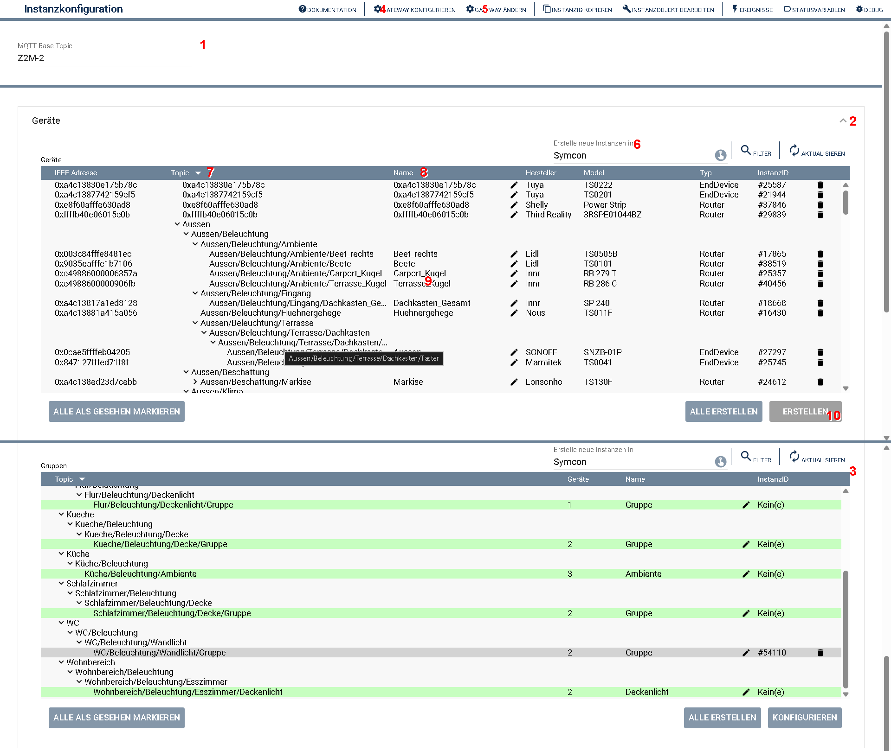

[Deutsch](README.md) | [English](README.en.md)

# Zigbee2MQTT Configurator

The configurator reads Zigbee2MQTT devices and groups and lets you create the corresponding Symcon instances. It is part of the [Zigbee2MQTT library](../README.en.md).

## Requirements and installation

- Symcon 9.1 or newer.
- A running [Zigbee2MQTT](https://www.zigbee2mqtt.io) installation and an MQTT broker, either Symcon's MQTT Server or an external broker such as Mosquitto.
- A configurator connected to the matching Symcon MQTT Client or MQTT Server and configured with the installation's MQTT base topic.
- A matching [Bridge instance](../Bridge/README.en.md) and the Symcon extension installed in Zigbee2MQTT. Install or update the extension manually from the Bridge.

Create the configurator through [Discovery](../Discovery/README.en.md), then apply its configuration. An MQTT configurator for generic MQTT devices is not required.

## Configuration and everyday use

| Control | Meaning |
| --- | --- |
| MQTT Base Topic | The base topic used by this Zigbee2MQTT installation. Different installations on the same broker need different base topics. |
| Devices | Devices and existing matching [Device instances](../Device/README.en.md). A missing Bridge is offered here as a normal configurator entry. |
| Groups | Groups and existing matching [Group instances](../Group/README.en.md). |
| Configure gateway | Opens the connected MQTT Client or Server. |
| Change gateway | Selects another MQTT splitter. Check that it belongs to the intended Zigbee2MQTT installation. |
| Create new instances in | The starting Symcon category for new instances. |
| Topic | The Zigbee2MQTT friendly name/topic, optionally containing a hierarchy separated by `/`. |
| Name | The last topic segment for a new instance, or the existing Symcon instance's name. |
| Create / Configure | Creates selected missing instances, or opens an existing instance. |

The Devices list is initially expanded; Groups is initially collapsed. Technical columns such as network address, description and power source are hidden by default. The screenshot shows both lists expanded for explanation. The row colors follow the [standard Symcon configurator conventions](https://www.symcon.de/en/service/documentation/basics/instances/configurators/).

If no device data are available, the Symcon extension may be missing or outdated. The missing Bridge can be created through the standard configurator mechanism. This supplies its MQTT connection and base topic. Open the Bridge to install or update the extension, then refresh the lists.

### Topic hierarchy

Friendly names such as `Floor/Room/Lighting/Lamp` appear as a hierarchy. The configurator creates the necessary categories below the selected starting category when you create instances. Use unique names and avoid empty path segments or a trailing `/`.

### Refreshing lists

The form builds its lists from the most recently available Bridge and Zigbee2MQTT data. The first response may take several seconds in a large network or after initial installation. Use **Refresh** after renaming devices, adding groups, pairing devices or updating the extension.

### Multiple Zigbee2MQTT installations

Instances are matched using both the connected MQTT splitter and the base topic. An instance on another splitter is never automatically adopted or changed. If the same physical device exists only as an instance on another connection, this configurator offers a separate instance on its own connection. Correct accidentally connected instances manually using normal Symcon configuration.

Existing instances on this configurator's splitter and base topic remain listed even if the physical device or group is absent from the current Zigbee2MQTT list. This allows you to inspect the existing configuration without confusing it with devices from another installation.

### Status messages

| Message or symptom | What to check |
| --- | --- |
| Instance has no active parent | Use Configure/Change gateway to select an active MQTT connection. |
| No devices found | Create/open the matching Bridge; check extension installation and incoming device information. |
| Zigbee2MQTT does not respond | Check the Zigbee2MQTT service, broker, connection and base topic. |
| An existing device/group appears as new | Check both the MQTT splitter and base topic of the existing instance. Different installations are intentionally isolated. |

## Variables, PHP functions and actions

The configurator creates no status variables and exposes no PHP functions intended for user scripts. Use its configuration form and the normal Symcon configurator controls. Form buttons such as Refresh are internal UI actions.

## Further information

- [Library installation and migration](../README.en.md)
- [Changelog](../CHANGELOG.en.md)
- [Beta release notes](../docs/BETA_RELEASE_NOTES.md#english)
- [License: CC BY-NC-SA 4.0](https://creativecommons.org/licenses/by-nc-sa/4.0/)

The module is free for non-commercial use. Optional support: [PayPal](https://www.paypal.com/cgi-bin/webscr?cmd=_s-xclick&hosted_button_id=EK4JRP87XLSHW) or the [author's wishlist](https://www.amazon.de/hz/wishlist/ls/3JVWED9SZMDPK?ref_=wl_share).
