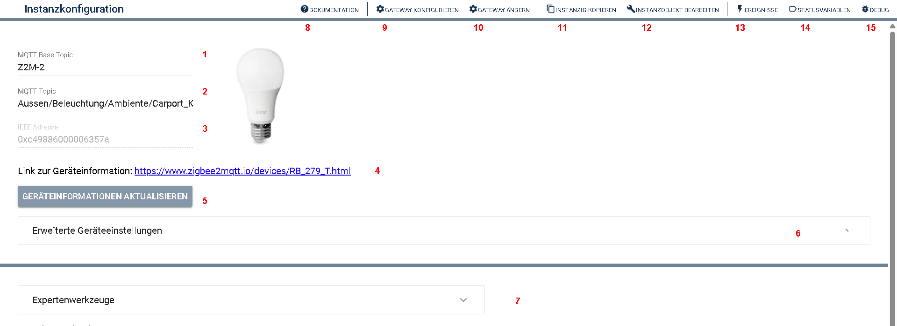
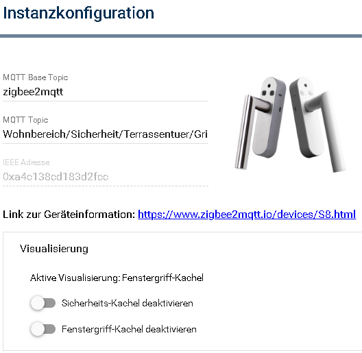

[Deutsch](README.md) | [English](README.en.md)

# Zigbee2MQTT Device

Represents one Zigbee2MQTT device in Symcon. The instance derives variables, actions and native presentations from the device's exposes and received payloads. Supported devices can also use a combined HTML-SDK tile.

## Contents

- [Requirements and installation](#requirements-and-installation)
- [Configuration and first use](#configuration-and-first-use)
- [Visualization](#visualization)
- [Device maintenance and removal](#device-maintenance-and-removal)
- [Device options](#device-options)
- [Binding and reporting](#binding-and-reporting)
- [Variables and maintenance](#variables-and-maintenance)
- [Operational notes](#operational-notes)
- [PHP functions](#php-functions)
- [Actions and further information](#actions-and-further-information)

## Requirements and installation

- Symcon 9.1 or newer, a working Zigbee2MQTT installation and an internal or external MQTT broker.
- Install this module as part of the [Zigbee2MQTT library](../README.en.md), then create devices using the [Configurator](../Configurator/README.en.md).
- Install/update the Symcon extension manually from the matching [Bridge](../Bridge/README.en.md). The library bundles extension **6.09**. A module update alone does not update the extension in Zigbee2MQTT.

## Configuration and first use



| Setting or area | Meaning |
| --- | --- |
| MQTT Base Topic | Base topic of this Zigbee2MQTT installation; normally supplied by the Configurator. |
| MQTT Topic | Device's `friendly_name`, initially usually its IEEE address. Renaming a device in Zigbee2MQTT changes its MQTT topic. Update the Symcon configuration manually or use the Configurator's topic correction. |
| IEEE address | Stable device identity independent of the friendly name. Do not change it casually. A deliberate one-for-one replacement with an equivalent device is a possible exception. |
| Device information | Model, documentation link and image. Images may differ from the actual device; validated, size-limited PNGs are cached by model under `user/IPSZigbee2MQTT/icons`. |
| Refresh device information | Reads exposes and device details again. A missing IEEE address discovered for an existing instance is suggested in the form only: check it, then use **Apply** to save. |
| Visualization | Displays the active combined tile and applicable options. |
| Advanced device settings | Less frequent regular tasks: maintenance, options, variables, binding and reporting. Only applicable sections are shown. |
| Expert tools | Advanced removal, stale-variable maintenance, debug export, IEEE editing and missing translations. The test center is a separate top-level area. |
| Gateway | The connected Symcon MQTT Client or MQTT Server. It must belong to the intended Zigbee2MQTT installation. |

After creation, check the IEEE address/topic/model, refresh the information if the Zigbee2MQTT definition changed, inspect **Variables**, and check the active visualization. Change device options, binding and reporting only when the intended behavior and device support are clear. Test commands through the corresponding variables or test center; battery devices may need waking.

## Visualization

The module selects the first applicable HTML-SDK tile, in this priority order:

1. Heating: setpoint, room temperature and heating-related features.
2. Switch/power metering: one or more switch channels, optionally power and energy measurements.
3. Window handle: closed/open/tilted state, alarms and supported buttons.
4. Security: contact, opening, tamper, smoke, gas, leakage or related alarms.
5. Actions: last button/remote action and available action values.
6. Sensors: temperature, humidity, soil moisture, illuminance, occupancy, presence and related values.
7. Symcon's standard visualization.

Disable an applicable specialized tile to allow the next applicable tile or the native visualization. Actuator/sensor combinations normally prioritize the actuator; **Use sensor tile** explicitly selects the sensor view when suitable values exist. Only relevant choices are displayed. Heating presets are configurable per instance; defaults are **18, 20 and 22 °C**. Tiles follow the Symcon theme and font, while semantic colors still mark alarms and states. Graph buttons are shown only for logged variables.



Lights, RGB/RGBW/RGBWW/tunable-white lights and covers use native Symcon presentations where appropriate. Only the actual state of a `light` expose gets the native light on/off role; auxiliary switches such as do-not-disturb or inching remain separate switches. Simple locks, fans and sirens use native switch, slider or enumeration presentations unless an appropriate combined tile exists.

Modern presentations are module defaults registered through `RegisterVariable*`. Existing variables are re-registered on Apply. User-defined profiles and presentations take precedence and are not overwritten. No new dynamic `Z2M.*` profiles or Symcon standard profiles are assigned as module defaults. Historical profile objects are not automatically deleted.

### Identify migration

> [!CAUTION]
> **IDENTIFY IS CREATED AS A NEW VARIABLE.** Update scripts, links and automations as needed to use its new ID and the string command `identify`, for example `RequestAction($newIdentifyVariableID, 'identify')`. Boolean `true` is not valid for the new action.

The retained Boolean variable keeps its ID, value, references, visibility, name, icon, description, position, profiles, presentations and custom action. Its ident becomes an internal legacy ident; only the obsolete module default action is disabled. Custom actions remain assigned and should be checked for continued compatibility. Old module calls are not automatically forwarded. Migration sends no identify command.

Settings already changed or removed by earlier Testing versions cannot be reconstructed automatically; inspect a backup if restoration is required. The new enum shows the last command sent through its action, not a persistent device state. Single-use commands appear as separate buttons and do not compete with a light's actual state switch.

### Temperature

Expose-provided minimum/maximum values determine the native temperature range. If missing, the per-instance fallback defaults to **−40 to 80 °C**. This changes presentation bounds only, not device values or the Zigbee2MQTT expose.

### Color temperature and color

For `color_temp`, the module adds `color_temp_kelvin` for native light control; the original property remains in Mired. Presets use a separate enumeration. Conversion is `kelvin = 1000000 / mired`, so the order of the bounds is reversed. For example, 200–454 Mired corresponds to approximately 2202–5000 K. If no bounds exist, the fallback is 1000–12000 K.

If the Zigbee2MQTT definition reports incorrect bounds, set both positive Kelvin bounds in **Color temperature visualization**. `0`/`0` restores expose-derived bounds. The override controls the native Kelvin range, clamps Kelvin actions and adjusts the derived white color; it does not change Zigbee2MQTT or the lamp's capabilities.

RGB/HS/XY exposes use integer Hex/sRGB values and the native color presentation without a module profile. Pure tunable-white lights additionally get a derived `color` value representing the white tone; this does not provide RGB control. Native RGB control and native light detail views remain available.

## Device maintenance and removal

Under **Advanced device settings → Device maintenance**:

| Action | Behavior |
| --- | --- |
| Interview device | Re-reads endpoints, clusters and basic attributes, useful after firmware changes or incomplete discovery. |
| Configure device | Runs the `configure` function of the Zigbee2MQTT device definition again. It may restore bindings, reporting intervals or device-specific settings. Not every definition supports it. |

Both require confirmation and may take up to two minutes. Wake battery devices immediately beforehand. After an interview refresh device information; after configuration refresh endpoint data as needed. Configure is not a factory reset or re-pairing operation and does not rename the device, but may replace manually tuned binding/reporting settings with the definition's defaults.

Under **Expert tools → Advanced device removal**, every action requires separate confirmation:

| Action | Behavior |
| --- | --- |
| Remove normally | Asks an online device to leave the Zigbee network. |
| Force removal | Removes the database entry without making the device forget the network key. Factory-reset it before pairing again. |
| Remove and block | Removes normally and adds the device to the blocklist. Remove it from the blocklist before pairing again. |

These commands do not delete the Symcon instance or its variables. Use force removal only when normal removal persistently fails.

## Device options

Known general options and device-specific `definition.options` appear under **Advanced device settings → Device options**, with current value, type and description. **Edit** selects a typed editor: Boolean switch, enumeration, number/text input, JSON array/object, or an attribute selector. Changes are sent to Zigbee2MQTT via `bridge/request/device/options`; a matching Bridge is used to check responses when available.

General options include `debounce`, `debounce_ignore`, `disable_automatic_update_check`, `disabled`, `filtered_attributes`, `filtered_cache`, `filtered_optimistic`, `homeassistant`, `icon`, `optimistic`, `qos`, `retain`, `retention`, `throttle` and `transition`.

| Common option | Meaning |
| --- | --- |
| `transition` | Default transition duration, e.g. for lights. |
| `debounce` | Delays/combines rapid reports. |
| `optimistic` | Publishes expected state before device confirmation. |
| `retain` | Keeps the last MQTT message for new subscribers. |
| `filtered_attributes` | Removes selected properties from published payloads. |
| `disabled` | Disables the device in Zigbee2MQTT. |
| `qos` | MQTT quality of service. |

Use valid JSON for collections, for example `["battery"]` or `{"key":"value"}`. Attribute candidates come from exposes, the catalog, existing variables and saved values. The Bridge reports when Zigbee2MQTT requires a restart for changed options.

## Binding and reporting

Binding sends selected clusters directly from a source endpoint to a target device or group. Reporting controls automatic attribute reports and their timing/change thresholds. Unsupported devices, endpoints or attributes cannot be made to support these functions by selecting them in Symcon.

When endpoint data exists, the form displays endpoint names, input/output clusters, bindings and configured reporting entries. The overview reads the `bridge/devices` cache; there is no separate Zigbee2MQTT “read bindings” request. **Refresh endpoint data** re-reads that cache and is independent of the extension's `getDeviceInfo` request. Newly changed bindings may take time to appear.

Targets are restricted to the same MQTT splitter and base topic, including devices/groups known by the matching Bridge without their own Symcon instance. Select the correct source endpoint and supported clusters. **Keep reporting when unbinding** sends `skip_disable_reporting`.

Reporting fields are endpoint, cluster, attribute, minimum interval, maximum interval, reportable change and optional options JSON. Small intervals increase radio traffic and battery consumption. **Configure reporting** writes the selected settings; **Read reporting** asks for the device's current configuration. Wake battery devices before either operation.

## Variables and maintenance

The local catalog remembers definitions from exposes, payloads and system messages. **Refresh variables** rebuilds it from current data without deleting actual variables. Explicitly disabled/deleted definitions are retained while still relevant to the device. Composite exposes contribute their usable child variables, not an unusable composite parent.

| Catalog state | Meaning and action |
| --- | --- |
| Created | Exists; **Disable** prevents automatic recreation after later deletion. |
| Not created | Known but missing; **Create** explicitly creates it. |
| Disabled, exists | The object is retained; **Enable** permits recreation. |
| Deleted | A previously allowed variable is missing; use **Create** to restore it. |

Manual deletion is respected and does not lead to immediate automatic recreation. Newly received values can add definitions and permitted variables. OTA-capable devices retain stable `update__installed_version`, `update__latest_version` and `update__state` definitions when rebuilding; transient progress/remaining values are retained only while present in the latest payload. Unsupported devices do not retain historical OTA metadata indefinitely. Availability appears only when Zigbee2MQTT availability messages are received.

**Expert tools → Variable maintenance** inspects only direct child variables. Logged or referenced variables are protected. Clear candidates, uncertain review candidates and scan notices are separate. Deletion requires another ownership/protection check and explicit confirmation. The Bridge overview can open the owning instance but does not centrally delete these variables. Scan notices indicate incomplete/skipped checks, not deletion candidates. **Presentation changes** records replacement of old `Z2M.*` module profiles; it does not overwrite custom settings.

## Operational notes

- Missing endpoints/bindings: refresh endpoint data and check the Zigbee2MQTT interview/cache. Refresh device information separately when exposes are missing.
- Device-information timeout: verify that Zigbee2MQTT and the matching extension are online; retry after startup has completed.
- Offline/sleeping device: check power, wake it and retry. A missing configure function cannot be fixed by retrying.
- Missing tile: inspect applicable/disabled tiles and exposes. Incorrect Kelvin bounds can be overridden in the presentation settings.
- Enum state commands preserve Zigbee2MQTT values. Covers may require `OPEN`, `CLOSE`, `STOP`, not Boolean or `ON`/`OFF`.
- Classic WebFront may show raw values/input fields for newly created native presentations until the browser page is reloaded. Reproduced independently of the module under Symcon 9.1 and reported under 9.0; tile visualization is unaffected.
- For support, use the instance's debug output or **Download debug data** and review exports before sharing them.

## PHP functions

`InstanceID` is the device instance ID; `VariableID` identifies an actual child variable. Functions that send MQTT commands normally indicate sending success, not confirmed physical device state. Read requests are asynchronous; values arrive later through MQTT.

| Signature | Behavior |
| --- | --- |
| `RequestAction(int $VariableID, mixed $Value)` | Uses the variable's actual action, including a custom action. Never call it recursively on the same variable inside its custom action script. |
| `bool Z2M_WriteValueBoolean(int $InstanceID, string $Ident, bool $Value)` | Calls the module action for a Boolean ident. |
| `bool Z2M_WriteValueInteger(int $InstanceID, string $Ident, int $Value)` | Calls the module action for an integer ident. |
| `bool Z2M_WriteValueFloat(int $InstanceID, string $Ident, float $Value)` | Calls the module action for a float ident. |
| `bool Z2M_WriteValueString(int $InstanceID, string $Ident, string $Value)` | Calls the module action for a string ident, e.g. `identify`. |
| `mixed Z2M_ReadValue(int $InstanceID, string $Property)` | Sends a single-property `/get` request; does not synchronously return the measured value. The property must support GET. |
| `bool Z2M_SendGetCommand(int $InstanceID)` | Requests only properties marked readable in exposes and not filtered; returns false when none exist. |
| `bool Z2M_SendSetCommand(int $InstanceID, array $Payload)` | Sends a generic JSON `/set` payload. |
| `bool Z2M_Command(int $InstanceID, string $Topic, string $Value)` | Sends an object/array JSON payload below this device's topic, e.g. `set`. |
| `bool Z2M_CommandExt(int $InstanceID, string $Topic, string $Value)` | Sends an object/array JSON payload below the configured base topic, without the device topic. |
| `bool Z2M_SetColorExt(int $InstanceID, int $Color, int $TransitionTime)` | Sets a native RGB/HS/XY color with an integer transition duration in seconds. Returns false without a native color expose. |
| `string Z2M_UIExportDebugData(int $InstanceID)` | Returns a `data:application/json;base64,...` URI containing the support export, not raw JSON. |

`Z2M_WriteValue*` addresses the module action, bypassing a variable's custom action; its Boolean return is not a device acknowledgement. `Command`/`CommandExt` require valid JSON objects or arrays, not scalar values. For `CommandExt(12345, 'Room/Lamp/get', '{"state":""}')`, the final topic is `{BaseTopic}/Room/Lamp/get`.

```php
RequestAction(12345, true);              // Switch variable ID
RequestAction(12346, 'OPEN');            // Cover state variable ID
RequestAction(12347, 'identify');        // New identify variable ID
Z2M_WriteValueString(23456, 'effect', 'blink');
Z2M_SendSetCommand(23456, ['brightness_step_onoff' => 10]);
Z2M_SetColorExt(23456, 0xFFAA00, 2);
```

In XY/HS/HSV modes with a separate brightness feature, changing color preserves brightness. Black (`0x000000`) has no hue, so that call succeeds without sending MQTT or changing brightness/color. Switch off using state/brightness. Without separate brightness, brightness can be derived from the color. The same semantics apply to actions on the color variable.

## Actions and further information

Writable variables support Symcon's standard “set value” action. Additional instance actions cover toggle, timed on/off, brightness/color-temperature steps and movement, transitions, color and scene recall. They appear only when their required idents exist. See the [complete action reference](../actions/README.en.md). Scenes must already exist and be supported by the target.

[Changelog](../CHANGELOG.en.md) · [Beta migration notes](../docs/BETA_RELEASE_NOTES.md) · [Library documentation](../README.en.md) · [License: CC BY-NC-SA 4.0](https://creativecommons.org/licenses/by-nc-sa/4.0/)

The module is free for non-commercial use. Donations are optional: [PayPal](https://www.paypal.com/cgi-bin/webscr?cmd=_s-xclick&hosted_button_id=EK4JRP87XLSHW), [Amazon wishlist](https://www.amazon.de/hz/wishlist/ls/3JVWED9SZMDPK?ref_=wl_share).
