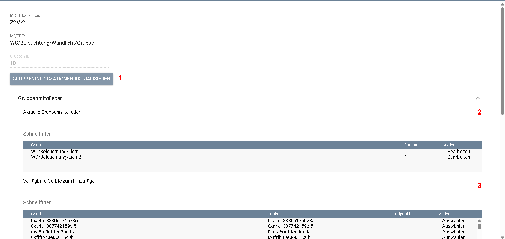

[Deutsch](README.md) | [English](README.en.md)

# Zigbee2MQTT Group

Represents a Zigbee2MQTT group as one Symcon instance. Group control sends commands to several devices together; only supported group features can be controlled, not every property of every member. See Zigbee2MQTT's [device/group guide](https://www.zigbee2mqtt.io/guide/configuration/devices-groups.html).

## Requirements and installation

- Symcon 9.1 or newer, a working Zigbee2MQTT installation and an internal or external MQTT broker.
- Install the [library](../README.en.md), then create the group using the [Configurator](../Configurator/README.en.md).
- Install/update the Symcon extension manually through the matching [Bridge](../Bridge/README.en.md). The library bundles **6.09**; installing a module update alone does not update the Zigbee2MQTT extension.


## Configuration

Group configuration follows the [device instance](../Device/README.en.md#configuration-and-first-use). Use the correct MQTT base topic and group topic, connected to the same MQTT splitter as the matching Bridge. A group ID replaces the IEEE address. **Refresh group information** reads members, options, scenes and group exposes again.


The device/endpoint selector uses the existing device cache of the Bridge on the **same MQTT splitter and base topic**. Opening the form or selecting a device does not request a full device list via MQTT. Devices without a Symcon instance can be selected from this cache. Without a matching Bridge/cache, local instances and saved members remain available. New `bridge/devices` messages update the cache.

With extension **6.09**, dynamic group exposes are evaluated using current member options. Missing definitions or errors for one member no longer abort the whole group response. Other members and group metadata remain available; failed members are reconsidered on the next refresh after the underlying problem is fixed.

## Members



- **Refresh group information** updates members, group options and scenes, particularly after changes outside Symcon.
- **Current group members** shows devices and endpoints.
- **Available devices** includes local instances and devices known by the matching Bridge. A different Zigbee installation is excluded even if its base topic happens to be identical.
- Selecting a row in either list fills in **Device** and **Endpoint**. **Add member** and **Remove member** apply the selection.
- Select the correct endpoint for multi-channel devices. Endpoint choices come from cached device details.
- **Keep reporting when removing** sends `skip_disable_reporting` so existing reporting configuration need not be removed.

Changes go through the Bridge to Zigbee2MQTT. An offline member produces a readable form message; the detailed Zigbee2MQTT response is available in debug output. Group membership changes affect actual Zigbee devices.

## Group options

| Option | Type | Meaning |
| --- | --- | --- |
| `retain` | Boolean | Retain published group MQTT messages. |
| `transition` | Number | Default transition duration in seconds. |
| `optimistic` | Boolean | Update group state when a member changes state. |
| `qos` | Enumeration | Default (`-`) or MQTT QoS 0, 1, 2. |
| `off_state` | Enumeration | `all_members_off` or `last_member_state`, controlling group OFF/CLOSE publication. |
| `filtered_attributes` | Array | Attributes Zigbee2MQTT should omit from published payloads. |
| `homeassistant` | Object | Override Home Assistant discovery properties. |

Selecting a row fills in the current or default value in the appropriate editor. **Apply option** sends the new setting. Attribute lists combine exposes, existing variables and saved values. Objects must be valid JSON, e.g. `{"key":"value"}`. The Bridge reports when Zigbee2MQTT requires a restart.

## Scenes

Selecting a scene fills in its ID and name. Use the corresponding buttons to store the current group state, add an extended JSON scene, recall, rename or delete a scene. **Scene JSON** supplies extended values such as brightness or color when adding a scene. Recall sends the scene ID to the group, reducing traffic compared with individual state commands. A scene must exist before recall, and members must support Zigbee scenes.

## Variables and visualization

Variables are created dynamically from the group's current exposes and payloads. Types, actions and native module-default presentations follow those definitions. User-defined profiles and presentations take precedence and are not overwritten. No new dynamic `Z2M.*` profiles or Symcon standard profiles are assigned as module defaults. Existing profile objects are not deleted automatically.

Light groups use native Symcon light visualization, with color, brightness, Kelvin control and presets where supported by the group exposes. Other applicable combined tiles and the variable catalog follow the [device documentation](../Device/README.en.md#visualization).

**Advanced device settings → Variables** manages created, not-created, disabled and manually deleted definitions. Disabling does not delete an object; deletion is respected until explicit recreation. **Expert tools → Variable maintenance** inspects only direct variables. Logged/referenced variables are protected; deletion requires explicit confirmation after renewed checks. Clear candidates, review candidates and scan notices are separate. A notice means the scan was incomplete or skipped, not that an object should be deleted. The Bridge can open the owning instance but does not delete its variables centrally. The test center is a separate top-level area.

> [!NOTE]
> Classic WebFront can initially show raw values/input fields for newly created native presentations. Reload the browser page to load the correct presentations. This was reproduced independently of the module under Symcon 9.1 and reported under 9.0; tile visualization is unaffected.

If the group exposes an identify command, the same [identify migration warning](../Device/README.en.md#identify-migration) applies: a new string variable uses `identify`; retained Boolean variables keep user settings but lose the obsolete module default action. Check references and custom scripts.

## PHP functions

`InstanceID` means the group instance ID, while `VariableID` identifies an actual child variable. Group commands affect the physical group. Sending success does not mean all members acknowledged the requested change.

| Signature | Behavior |
| --- | --- |
| `RequestAction(int $VariableID, mixed $Value)` | Calls the variable's actual action. Do not recursively call the same variable from its own custom action script. |
| `bool Z2M_WriteValueBoolean(int $InstanceID, string $Ident, bool $Value)` | Calls the module action for a Boolean ident. |
| `bool Z2M_WriteValueInteger(int $InstanceID, string $Ident, int $Value)` | Calls the module action for an integer ident. |
| `bool Z2M_WriteValueFloat(int $InstanceID, string $Ident, float $Value)` | Calls the module action for a float ident. |
| `bool Z2M_WriteValueString(int $InstanceID, string $Ident, string $Value)` | Calls the module action for a string ident. |
| `mixed Z2M_ReadValue(int $InstanceID, string $Property)` | Sends a single-property GET request; does not synchronously return the measured value. The target must support GET. |
| `bool Z2M_SendGetCommand(int $InstanceID)` | Requests only expose properties with GET access that are not filtered; returns false if none exist. |
| `bool Z2M_SendSetCommand(int $InstanceID, array $Payload)` | Sends an object payload to the group `/set` topic. |
| `bool Z2M_Command(int $InstanceID, string $Topic, string $Value)` | Sends object/array JSON below the configured group topic, e.g. `set`. |
| `bool Z2M_CommandExt(int $InstanceID, string $Topic, string $Value)` | Sends object/array JSON below the configured base topic, without the group topic. |
| `bool Z2M_SetColorExt(int $InstanceID, int $Color, int $TransitionTime)` | Sets a native RGB/HS/XY color with a whole-second transition, when supported. |
| `string Z2M_UIExportDebugData(int $InstanceID)` | Returns the support export as a `data:application/json;base64,...` URI, not raw JSON. |

`Z2M_WriteValue*` bypasses the variable's custom action and its return is not a device acknowledgement. GET responses arrive asynchronously. `Command` and `CommandExt` require valid JSON objects or arrays. `CommandExt(12345, 'Room/Lamp/get', '{"state":""}')` sends to `{BaseTopic}/Room/Lamp/get`.

```php
RequestAction(12345, true); // Group's state VARIABLE ID
Z2M_SendSetCommand(23456, ['brightness_step_onoff' => 10]); // Group INSTANCE ID
Z2M_WriteValueString(23456, 'effect', 'blink');
Z2M_SetColorExt(23456, 0xFFAA00, 2);
Z2M_SendSetCommand(23456, ['scene_recall' => 1]);
```

In XY/HS/HSV modes with separate brightness, color changes preserve brightness. Black (`0x000000`) has no hue: the color call returns true without sending MQTT or changing state. Switch off through state/brightness. Without separate brightness, brightness may still be derived from color. A native color expose is required for `Z2M_SetColorExt`.

Use the [Bridge's group and scene functions](../Bridge/README.en.md) for membership, options and scene administration; these are distinct from this instance's state commands.

## Actions and further information

Writable variables support Symcon's standard set-value action. Additional instance actions include timed on/off, toggle, transitions, brightness/color-temperature movement and steps, color, and scene recall. Only actions with the required idents are offered. See the [action reference](../actions/README.en.md).

[Library documentation](../README.en.md) · [Changelog](../CHANGELOG.en.md) · [Beta notes](../docs/BETA_RELEASE_NOTES.md) · [CC BY-NC-SA 4.0](https://creativecommons.org/licenses/by-nc-sa/4.0/)

Free for non-commercial use. Optional donations: [PayPal](https://www.paypal.com/cgi-bin/webscr?cmd=_s-xclick&hosted_button_id=EK4JRP87XLSHW), [Amazon wishlist](https://www.amazon.de/hz/wishlist/ls/3JVWED9SZMDPK?ref_=wl_share).
