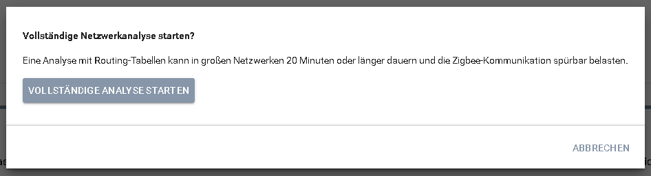
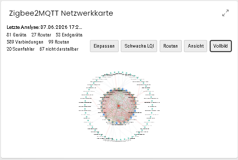
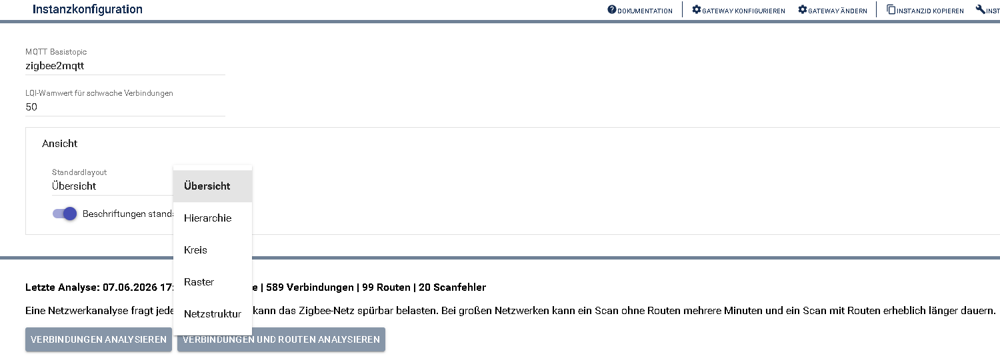
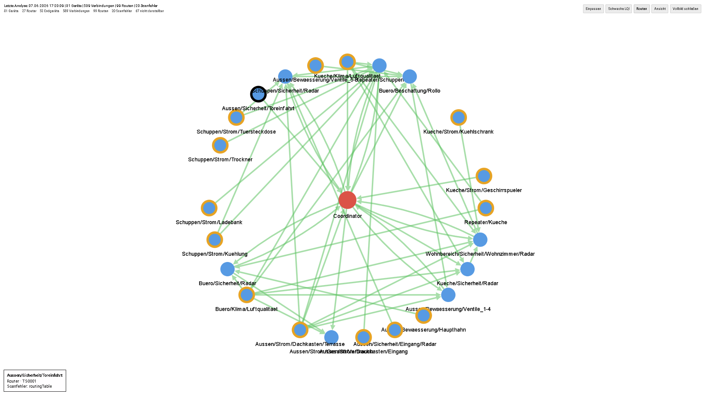

[Deutsch](README.md) | [English](README.en.md)

# Zigbee2MQTT Network Map

Analyzes Zigbee devices, directed links, routing tables and scan failures. The latest complete result is stored locally and displayed in an interactive HTML-SDK tile.

## Requirements and setup

Requires Symcon 9.1 or newer, a working Zigbee2MQTT installation and its reachable Symcon MQTT Client or MQTT Server. Install as part of the [library](../README.en.md).

1. Create a **Zigbee2MQTT Network Map** instance.
2. Select the same MQTT parent as the matching Zigbee2MQTT Bridge.
3. Enter the Zigbee2MQTT installation's base topic.
4. Optionally set the LQI warning threshold and initial layout.
5. Start a network analysis.

The warning threshold marks links as weak; it does not change radio behavior. Initial layout/label settings apply when opening the tile. Changes made inside an open tile affect only that view, not saved instance settings.

## Network analysis

- **Analyze links** requests LQI/neighborhood data without routing tables.
- **Analyze links and routes** also reads the routers' routing tables and requires confirmation in the form.

Scanning queries reachable routers sequentially and increases Zigbee traffic. Run a full route scan only when needed. It can take 20 minutes or more on large networks and affect normal communication. A roughly 100-device/69-router example took about four minutes without routes and 18 minutes with routes; these are examples, not time limits.

Scanning is asynchronous; Symcon does not block while waiting and the form shows elapsed time. A second scan cannot start while one is running. **Reset scan status** resets only Symcon's local state, not an already running Zigbee2MQTT scan.

## Diagnostic views

The form lists devices (type, model, network/IEEE address, last seen and scan status), directed links (LQI, relationship, depth and associated route count), routing entries (destination, next hop, status) and failed LQI/routing queries.

LQI is directional; outgoing and incoming values can differ. A low LQI, a missing edge or one failed query is a diagnostic hint, not proof that a device is broken or offline. Only responses matching the current scan transaction are accepted; old or unsolicited responses do not replace the current result.

## Interactive tile

Coordinator, routers and end devices use distinct styling. Click a node for details, drag it, zoom, fit the graph, search by name/model/type/IEEE or network address, focus the selected node's immediate neighbors, and toggle labels. The tile never starts a network scan by itself.

| Control | Behavior |
| --- | --- |
| Fit | Centers the visible nodes/edges and fits them to the tile area. |
| Weak LQI | Displays only links below the configured warning threshold. |
| Routes | Displays only links with routing entries from the last scan. Requires a scan including routes to be meaningful. |
| View | Opens layout, search, neighborhood focus and label controls. |

### Layouts and search

| Layout | Use |
| --- | --- |
| Overview | Rings for coordinator, routers and end devices; a useful starting point for large networks. |
| Hierarchy | Layered layout for smaller networks or route analysis. |
| Circle | Evenly distributes visible nodes on a circle. |
| Grid | Regular grid, useful for dense views. |
| Network structure | Cytoscape's connection-driven layout; may require more space on large networks. |

**Find device** searches the known identifiers. **Neighborhood** limits the view to the selected node and direct neighbors; **Show all** removes that restriction. Default layout and label visibility are saved in the instance configuration; tile controls are temporary.

### Expand the network map

The tile's maximize arrow opens the interactive map in Symcon's expanded view.

### Route view and details

| Marker | Meaning |
| --- | --- |
| Red node | Coordinator. |
| Blue node | Router. |
| Turquoise node | End device. |
| Green arrow | Directed link with at least one route entry. |
| Orange border | At least one query failed for that device in the last scan. |
| Contrasting border | Selected device. |

The arrow follows source-to-target direction in Zigbee2MQTT's topology data. It does not show the guaranteed real-time path of every Zigbee packet. Routes change and scans can be incomplete.

Click a device for its friendly name/IEEE, type/model and failed queries. `Scan error: routingTable` means the routing table could not be read during that scan, for example because of timeout, temporary communication problems or unsupported/unanswered requests. It does not by itself mean the router is offline or faulty. A later scan may produce a different result. Click empty graph space to close details.

The graph uses locally bundled [Cytoscape.js](https://js.cytoscape.org/) under the [MIT license](assets/CYTOSCAPE-LICENSE.txt); no external web assets are loaded for the graph.

## Exports

The stored RAW analysis can be exported locally as JSON, Graphviz DOT or PlantUML without an additional scan. Export files are timestamped and written under `user/IPSZigbee2MQTT/networkmaps` on the Symcon server, avoiding the limited script output/download buffer for large networks. JSON is useful for analysis; DOT and PlantUML can be rendered in external tools.

## PHP functions

| Signature | Behavior |
| --- | --- |
| `bool Z2M_StartNetworkScan(int $InstanceID, bool $IncludeRoutes)` | Starts an asynchronous RAW scan, optionally including routing tables. |
| `bool Z2M_ResetNetworkScanStatus(int $InstanceID)` | Resets local scan status only. |
| `string Z2M_ExportNetworkMapRaw(int $InstanceID)` | Returns the last stored RAW analysis as JSON. |
| `string Z2M_ExportNetworkMapGraphviz(int $InstanceID)` | Generates DOT from the stored topology. |
| `string Z2M_ExportNetworkMapPlantUML(int $InstanceID)` | Generates PlantUML from the stored topology. |
| `string Z2M_CreateNetworkMapExportFiles(int $InstanceID)` | Writes the three export files; returns the directory path, or an empty string on failure. |

Only `Z2M_StartNetworkScan` requests fresh data. All exports operate on the last fully received result.

[Library documentation](../README.en.md) · [Changelog](../CHANGELOG.en.md) · [CC BY-NC-SA 4.0](https://creativecommons.org/licenses/by-nc-sa/4.0/)
